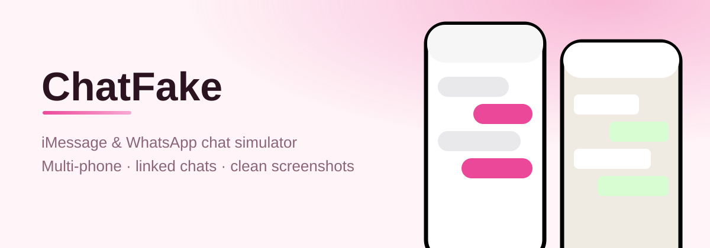

# 💬 ChatFake

**Simulador de móvil con iMessage y WhatsApp: varios teléfonos vinculados, contactos, llamadas, pantalla de bloqueo e inicio, y capturas limpias.**

[**▶ Showcase**](https://maariaaledesmaa.github.io/chatfake-showcase/) · [**🧪 Probar la demo**](https://maariaaledesmaa.github.io/chatfake-showcase/demo.html)

---

## ✨ ¿Qué es?

ChatFake es una app web local para crear conversaciones creíbles. Cada perfil es el **móvil de un personaje**, con sus chats, contactos, llamadas y aspecto propios, y los móviles se conectan entre sí como en la vida real.

## 🚀 Funciones destacadas

### 📱 Perfiles y móviles

- Perfiles ilimitados: cada uno es el móvil de un personaje, con sus propios chats y ajustes
- Pantalla de selección de perfil al entrar
- Modo claro u oscuro, color de burbujas, foto de perfil y fondo de chat por móvil
- Nivel de batería configurable, que se refleja en la barra de estado

### 💬 Mensajería iMessage y WhatsApp

- Dos apps con interfaz fiel que comparten los mismos chats: Mensajes (iMessage) y WhatsApp
- Chats individuales y grupales en una sola lista, ordenados por el último mensaje
- Imágenes, respuestas citadas, reacciones, edición y borrado de mensajes
- Escribir como cualquier miembro del chat
- Hora y estado editables por mensaje: 1 check, 2 grises o 2 azules, y "Enviado / Entregado / Leído" en iMessage
- Los checks azules llegan solos cuando el otro perfil abre el chat
- Separadores de fecha, nombre del remitente en grupos y pulsar un nombre para saltar a su móvil
- Grupos con nombre, foto y participantes editables; duplicar y eliminar chats
- Chats vinculados entre móviles, como en la vida real

### 🔒 Pantalla de bloqueo y notificaciones

- Hora, fecha y fondo personalizable
- Notificaciones que abren el chat, se responden en el momento, se borran una a una o todas a la vez
- Notificaciones personalizadas: 12 iconos de apps (WhatsApp, Instagram, X, Telegram, Gmail…) o tu propia imagen, con título, mensaje y hora
- Widgets: batería, música sonando, próximo evento y tiempo
- Se desbloquea tocando la barra inferior o el texto

### 🏠 Pantalla de inicio

- Fondo propio o el de bloqueo por defecto
- Apps funcionales: Mensajes, WhatsApp, Contactos y Teléfono, con insignias de no leídos
- 29 apps decorativas (Instagram, TikTok, Spotify…) elegibles con selección múltiple
- Se añaden desde el panel o tocando un hueco libre de la cuadrícula
- Dock y gesto de la barra inferior para volver a inicio

### 👤 Contactos

- Lista alfabética con buscador y "Mi tarjeta"
- Ficha completa: foto, nombre, empresa, móvil, correo, cumpleaños y notas
- Formulario como el de iOS, con un único desplegable para vincular el contacto a un perfil (relación 1:1)
- La ficha muestra "Sincronizado con el dispositivo" en lugar del perfil vinculado
- Al crear un contacto aparece su chat; los datos son distintos en cada móvil
- Editar y eliminar contactos

### 📞 Teléfono y llamadas

- Historial de llamadas editable (Todas y Perdidas)
- Añadir, editar o borrar llamadas con contacto o número desconocido, fecha, tipo y duración
- Llamadas a pantalla completa: entrante, saliente y en curso con cronómetro
- Con contactos aparece su nombre y foto; al colgar se guardan en el historial

### 📸 Capturas limpias

- Botón de cámara fuera del móvil: la captura se copia al portapapeles
- Sin barra de estado ni barra de escribir en los chats
- Bloqueo, inicio y llamadas se capturan completos
- Copia automática en una carpeta del ordenador (opcional)

### 🛠 Utilidades y personalización

- Recortador de imágenes con arrastre, zoom y proporciones (fotos de perfil, imágenes de chat, iconos)
- Exportar e importar todo en un archivo JSON
- Datos guardados en el navegador (IndexedDB), sin servidores
- Panel exterior en tema claro u oscuro
- Versión móvil de una sola página, con panel deslizante y menús con pulsación larga

## 📖 Guía de uso completa

Pulsa en cada apartado para ver todos los detalles.

<b>🚀 Primeros pasos y estructura</b>

- ChatFake es una app web local: un único archivo HTML que se abre con doble clic en Chrome, Edge u Opera, sin instalar nada ni usar servidores.
- Los datos se guardan en el navegador (IndexedDB), así que persisten al cerrar la pestaña. Solo hace falta internet para cargar la librería de capturas (html2canvas).
- La pantalla tiene dos zonas: el móvil, en el centro, y el panel de herramientas, a la izquierda. El panel queda fuera del móvil, por lo que nunca aparece en las capturas.
- Flujo general: eliges un perfil, llegas a su pantalla de bloqueo, la desbloqueas, entras en la pantalla de inicio y abres las apps (Mensajes, WhatsApp, Contactos, Teléfono).
- El botón del panel "🌙 Tema oscuro / ☀ Tema claro" cambia el aspecto de todo lo que está fuera del móvil (panel, formularios y menús) y recuerda tu elección.
- En pantallas estrechas (móvil) el móvil ocupa toda la pantalla, la página queda fija y el panel se abre desde la pestaña ☰ del borde izquierdo. Se cierra al pulsar fuera, al elegir una opción o al hacer una captura.

<b>📱 Perfiles (los móviles)</b>

- Cada perfil es el móvil de un personaje y su pantalla de inicio es la lista de perfiles. Puedes crear perfiles ilimitados con "Nuevo perfil".
- Al crear un perfil eliges el nombre del personaje y la app de mensajería por defecto (iMessage o WhatsApp). Se crea también el personaje dueño de ese móvil.
- Se entra en un móvil pulsando su tarjeta, y desde el panel "👥 Cambiar perfil" vuelves a la lista.
- Ajustes del perfil (⚙ en el panel): nombre; app de mensajería por defecto (la que usan las notificaciones y las insignias); modo oscuro; color de burbujas enviadas (o el color por defecto); fondo de chat con imagen (WhatsApp); fondo de la pantalla de bloqueo; fondo de la pantalla de inicio; tu foto de perfil con recortador; y la casilla para quitar todos los fondos personalizados.
- "Eliminar este perfil" pide confirmación: borra sus notificaciones y deja de mostrar sus chats en ese móvil, pero el personaje y sus chats con otros no se pierden.
- Cada móvil guarda por separado su aspecto, sus contactos, su historial de llamadas, sus widgets, sus apps decorativas y su nivel de batería.

<b>🔒 Pantalla de bloqueo y notificaciones</b>

- Muestra la hora y la fecha en vivo, la barra de estado con isla dinámica, señal y batería, y un fondo con degradado propio de cada móvil o tu imagen.
- Las notificaciones aparecen apiladas con icono, título, texto y hora ("ahora" si tiene menos de un minuto). Llegan cuando alguien escribe a ese móvil desde otro; no llegan si ese móvil ya está viendo ese chat.
- Tocar una notificación abre directamente ese chat. El botón ⋯ la despliega con un campo "Responder…": al enviar, el mensaje se manda como dueño del móvil, la notificación desaparece y se avisa a los demás miembros. La × la borra y "Borrar todo" aparece cuando hay más de una.
- Las notificaciones de WhatsApp muestran como icono la foto de perfil del remitente, en círculo, tal y como esa persona está guardada en ese móvil. Si no está guardada como contacto, no tiene foto o ocurre algo raro, se muestra el icono de WhatsApp. En grupos se usa la foto de quien escribe. Las de Mensajes llevan el icono verde de iMessage.
- Crear notificación (🔔 en el panel): eliges el icono entre 12 apps (WhatsApp, Mensajes, Instagram, X, Telegram, Snapchat, TikTok, Facebook, Gmail, Correo, Teléfono, Calendario) o entre los contactos de ese móvil, que se actualizan solos cuando guardas contactos nuevos. Al elegir un contacto se rellenan el icono (su foto en círculo) y el nombre del remitente.
- También puedes subir tu propia imagen como icono (con recortador), escribir título y mensaje, poner una hora (vacío = ahora) y elegir en qué móvil aparece. Las notificaciones personalizadas no abren ningún chat: al pulsarlas se despliegan y permiten eliminarlas.
- Widgets (🧩 en el panel): batería (nivel de 1 a 100, que también se ve en la barra de estado), música sonando (canción y artista, con controles dibujados), próximo evento (título y hora) y tiempo (temperatura y estado). Salen en tarjetas translúcidas bajo la hora.
- Para desbloquear toca la barra inferior, el texto "Toca para desbloquear" o el botón de la cámara. El botón de la linterna es decorativo. El botón "🔒 Pantalla de bloqueo" del panel vuelve a esta pantalla.

<b>🏠 Pantalla de inicio</b>

- Usa tu fondo de inicio o, si no lo has puesto, el de la pantalla de bloqueo. Incluye puntos de página y un dock translúcido.
- Apps funcionales: Teléfono y Mensajes en el dock, WhatsApp y Contactos en la cuadrícula. Las insignias rojas indican las notificaciones sin leer de la app de mensajería elegida por defecto.
- La barra inferior de cualquier pantalla (el gesto de inicio) te lleva a inicio. Durante una llamada no funciona. También está el botón "🏠 Pantalla de inicio" en el panel.
- Añadir apps decorativas: botón "📱 Añadir apps" del panel, o clic izquierdo en un hueco libre de la cuadrícula (en la vista móvil, mantener pulsado; también funciona el clic derecho). El gesto solo actúa mientras queda algún hueco.
- El menú muestra 29 apps con su icono (Instagram, Facebook, TikTok, X, Snapchat, YouTube, Spotify, Telegram, Gmail, Mapas, Safari, Cámara, Fotos, Ajustes, Reloj, Calendario con el día actual, Notas, Música, Netflix, Pinterest, Reddit, Discord, LinkedIn, Amazon, Uber, App Store, Tiempo, Calculadora y Cartera). Se eligen con selección múltiple, con ✓ y un contador.
- El máximo es lo que cabe en la cuadrícula (4 por fila según la altura de la pantalla) menos WhatsApp y Contactos. Si la ventana se hace más baja, las que ya no caben se ocultan sin borrarse. Las apps añadidas son solo decoración y no responden al toque.

<b>💬 Mensajes (iMessage) y WhatsApp</b>

- Son dos apps con interfaz propia que comparten los mismos chats: Mensajes abre la interfaz de iMessage y WhatsApp abre la de WhatsApp.
- La lista mezcla chats individuales y grupos, ordenados por el último mensaje, con avatar, nombre, vista previa (con el nombre de quien escribe en grupos), hora e insignia de no leídos. iMessage lleva el título grande y el botón ✎. WhatsApp lleva cabecera clara con título verde, botón flotante ＋ y barra inferior decorativa.
- El botón ✎ / ＋ ofrece "Nuevo grupo" y "Nuevo contacto" (este te lleva al formulario de la app Contactos). Los chats individuales se crean al crear un contacto.
- Nuevo grupo: nombre, foto (con recortador) y participantes elegidos entre los contactos del móvil.
- El chat tiene cabecera con foto y nombre (en WhatsApp, "en línea" o la lista de miembros del grupo con tu nombre como "Tú" al final, e iconos de vídeo, llamada y menú), burbujas con cola, mensajes agrupados, separadores de fecha ("Hoy", "Ayer"), hora dentro de la burbuja en WhatsApp y barra de escribir propia de cada app. Enter envía.
- Selector "Escribir como" (panel): puedes enviar mensajes como cualquier miembro del chat, para simular las respuestas de los demás.
- El botón ＋ de la barra de escribir adjunta imágenes, que pasan por el recortador con proporciones Original, 1:1, 4:5, 16:9 y 9:16.
- Menú de mensaje (clic derecho, o mantener pulsado el clic o el dedo): reaccionar (❤️ 👍 😂 😮 😢 🙏, y al repetir se quita), "🕒 Hora y estado", "↩ Responder" (con cita), "✏ Editar" y "🗑 Eliminar".
- "Hora y estado": cambias la fecha y la hora (los mensajes se reordenan) y el estado: Automático, Enviado (1 check), Entregado (2 checks grises) o Leído (2 checks azules).
- Los checks son automáticos: un mensaje queda con 1 check hasta que el otro perfil abre ese chat, y entonces pasa a 2 azules. Si el destinatario no tiene móvil, se marca como leído. En iMessage aparece "Enviado", "Entregado" o "Leído" bajo tu último mensaje.
- En grupos se ve el nombre de cada remitente (pequeño sobre la burbuja en iMessage, de color dentro de la burbuja en WhatsApp). Pulsar un nombre cambia al móvil de esa persona con ese chat abierto; si no tiene móvil, avisa.
- Pulsar la foto de la cabecera abre el editor del grupo (si es grupo) o la ficha del contacto (si es individual). El botón "🎨 Personalizar chat" del panel hace lo mismo: en grupos cambia nombre, foto y participantes; en individuales cambia nombre y foto del contacto solo en ese móvil.
- Clic derecho (o mantener pulsado) sobre un chat de la lista: Personalizar, Duplicar chat o Eliminar chat.
- Los chats están vinculados: si dos personajes tienen móvil, el mismo chat existe en ambos y lo que se escribe en uno aparece en el otro.

<b>👤 Contactos</b>

- La app muestra la lista alfabética con secciones por letra, un buscador decorativo y "Mi tarjeta" arriba (abre los ajustes del perfil).
- La ficha incluye foto, nombre, empresa, los botones Mensaje (abre el chat en iMessage), Llamar (inicia una llamada saliente), Vídeo y Correo (decorativos), y los datos de móvil, correo, cumpleaños y notas.
- Al pie de la ficha pone "Sincronizado con el dispositivo" si el contacto está vinculado a un perfil, o "Guardado en iCloud" si no, sin nombrar nunca el perfil.
- Los contactos solo se crean desde esta app, con "＋" (o desde el "+" de Mensajes): nombre, apellidos, empresa, teléfono, correo, cumpleaños, notas y foto con recortador.
- Hay un único desplegable "Vincular a perfil", que solo ofrece perfiles que todavía no son contacto de ese móvil (relación 1:1). Queda bloqueado al editar.
- Al crear un contacto se crea su chat individual, que aparece enseguida en Mensajes y WhatsApp.
- Editar cambia cualquier dato; "Eliminar contacto" pide confirmación y borra también su chat individual. Los datos son por móvil: un mismo personaje puede tener otro nombre, foto o teléfono en cada teléfono.
- Los chats que ya existían cuentan como contactos aunque no se hayan creado desde la app.

<b>📞 Teléfono y llamadas</b>

- La pestaña Recientes es un historial de llamadas totalmente falso y editable, con filtros Todas y Perdidas. Cada fila muestra nombre (en rojo si es perdida), "móvil" o "desconocido", ↗ si es saliente, y la hora, "Ayer" o la fecha. La barra de pestañas lleva a Contactos; el resto son decorativas.
- El botón ＋ ofrece "Simular llamada" y "Añadir al historial". Pulsar una fila abre la edición: contacto o desconocido con número, tipo (Entrante, Saliente, Perdida), fecha y hora, duración en minutos y eliminar.
- Simular llamada (también con "📞 Simular llamada" del panel): eliges tipo (entrante, saliente o en curso) y contacto o desconocido con su número. La llamada ocupa toda la pantalla, con nombre y foto del contacto sobre el fondo del móvil oscurecido.
- Entrante: nombre, "móvil", botones Rechazar (queda como perdida) y Aceptar, más Recordarme y Mensaje (decorativos). Saliente: "llamando…" y botón de colgar. En curso: cronómetro y la cuadrícula de silenciar, teclado, altavoz, añadir, FaceTime y contactos (decorativos).
- Durante la llamada el panel ofrece "✅ Pasar a llamada en curso" y "⛔ Colgar". Al colgar se guarda en el historial con su duración y se vuelve a la pantalla anterior.

<b>📸 Capturas</b>

- El botón "📷 Captura" está fuera del móvil, así que nunca aparece en la imagen. Copia la captura en PNG al portapapeles.
- En un chat captura solo la cabecera y los mensajes, sin barra de estado ni barra de escribir. En las listas y apps captura la app, y en bloqueo, inicio y llamadas, la pantalla completa.
- En la vista móvil el panel se cierra antes de capturar.
- Carpeta de capturas (📁 en el panel): eliges una carpeta del ordenador y cada captura se guarda también allí como PNG. Si no eliges ninguna, solo va al portapapeles. Requiere Chrome, Edge u Opera y no está disponible en navegadores móviles.

<b>🖼 Recortador de imágenes</b>

- Se abre antes de aceptar cualquier imagen: foto de perfil (propia, de contacto o de grupo), imagen para enviar en un chat e icono propio de una notificación.
- Se encuadra arrastrando y con el deslizador de zoom. En fotos de perfil la vista es redonda; en imágenes de chat se eligen las proporciones Original, 1:1, 4:5, 16:9 o 9:16.
- Cancelar descarta la imagen y Aplicar la guarda optimizada.

<b>🧰 Utilidades y datos</b>

- "💾 Exportar todo" descarga todos tus datos en un archivo JSON y "📂 Importar" los carga de nuevo, reemplazando los actuales.
- Todo se guarda en el navegador, sin cuentas ni servidores.
- Los menús de mensajes, chats y huecos de inicio se abren con clic derecho en el ordenador y con pulsación larga en el móvil.
- Los formularios siguen el estilo de la app y respetan el tema claro u oscuro del panel.

## 🧪 Sobre la demo

[`demo.html`](demo.html) reproduce la interfaz del móvil con **datos inventados**: dos móviles vinculados (Emma y Liam), pantalla de bloqueo, inicio, mensajes, contactos y llamadas. Se limita a **5 clics** y después se bloquea. Crear, editar, capturas e importar/exportar no están disponibles en la demo.

## 🛠 Tecnología

HTML · CSS · JavaScript (sin frameworks) · IndexedDB · File System Access API · html2canvas

## 🔐 Código fuente

La aplicación completa es **privada por ahora**. Este repositorio solo contiene el showcase y la demo limitada.

**Para más información, contacta con la creadora → Instagram [@maariaaledesmaa](https://instagram.com/maariaaledesmaa)**

---

Creada para narrativa, maquetas y ficción. Por favor, no la uses para engañar a personas ni suplantar a individuos reales.
